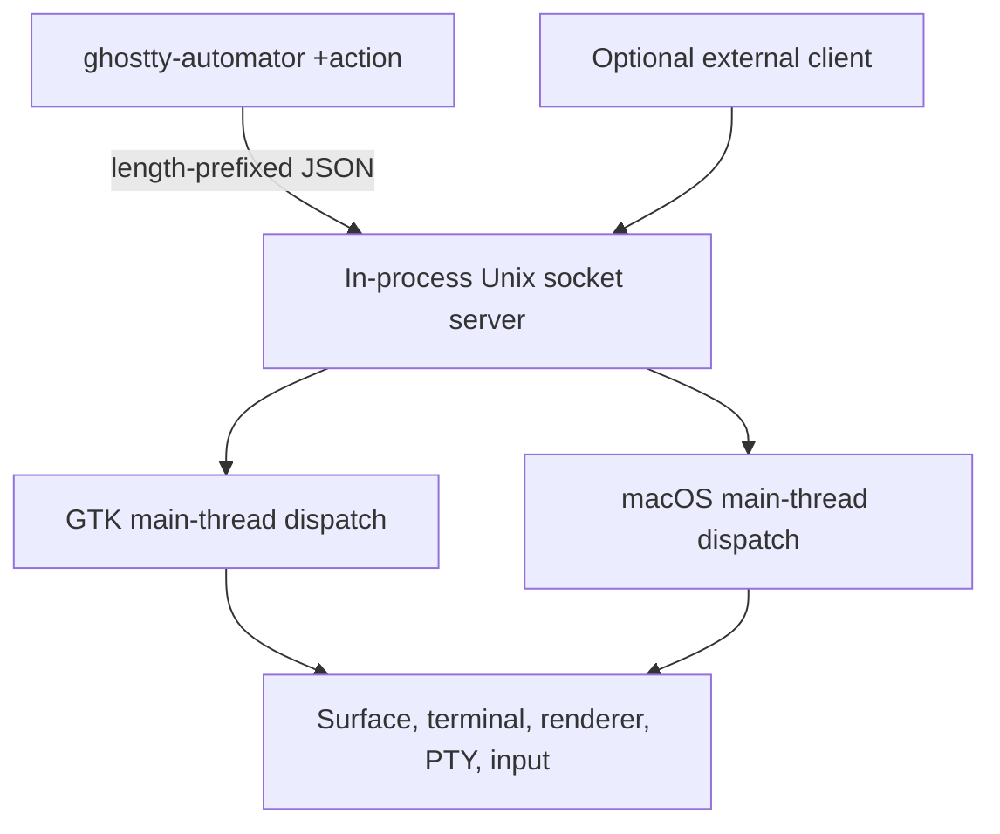

<h1 align="center">
  
  <br>
  Ghostty Automator
</h1>

<p align="center">
  <strong>Read, control, and capture real Ghostty terminal sessions from a single CLI</strong>
</p>

<p align="center">
  <a href="https://github.com/hyperb1iss/ghostty-automator/actions/workflows/cicd.yml">
    
  </a>
  <a href="https://github.com/hyperb1iss/ghostty-automator/releases">
    
  </a>
  <a href="LICENSE">
    
  </a>
</p>

Ghostty Automator is a fork of [Ghostty](https://ghostty.org) 1.3.1 for agents and
TUI testing. The CLI discovers windows, tabs, and splits; reads screen text and
cursor position; sends text, keyboard, mouse, and scroll events; and saves PNG
screenshots. Automation runs through a local Unix socket on Linux and macOS.

The terminal and client ship together. No separate daemon, Python environment,
or MCP server is required. Stock Ghostty sessions are separate from Automator
sessions.

## Install

The doctor and bootstrap commands are available in `v1.3.1-auto.2` and later.

Install the latest release and the agent skill with one command:

```bash
curl -fsSL https://raw.githubusercontent.com/hyperb1iss/ghostty-automator/automator/install.sh | bash
```

The installer uses writable directories in your home directory:

| Component                         | Default location                                |
| --------------------------------- | ----------------------------------------------- |
| CLI launcher                      | `~/.local/bin/ghostty-automator`                |
| Linux runtime and supporting data | `~/.local/lib/ghostty-automator/`               |
| macOS app                         | `~/Applications/Ghostty Automator.app`          |
| Agent skill                       | `~/.agents/skills/ghostty-terminal-automation/` |
| Claude Code skill link            | `~/.claude/skills/ghostty-terminal-automation`  |

If `~/.local/bin` is absent from PATH, use the printed absolute command or add it
to the current shell:

```bash
export PATH="$HOME/.local/bin:$PATH"
ghostty-automator +doctor
ghostty-automator +bootstrap
```

The installer preserves a separate existing Claude skill directory. Existing
agent sessions may need to restart to discover a newly installed skill.

The diagnostic command (`+doctor`) reports the executable, socket, capabilities,
and next command as JSON. The bootstrap command (`+bootstrap`) connects to a
running Automator or launches one, waits for a surface, and returns its ID in
`data.surface_id`. A graphical desktop session is required to launch the
terminal.

Bootstrap prefers an existing focused surface, then a surface in an active tab,
then the first available surface. Read that surface before sending input. To
keep a test separate from existing work, create a window with `+new-window` and
identify its new surface with `+list-surfaces --format=json`.

### Pinned, offline, and source installs

Download the installer to select a release or customize the destination:

```bash
curl -fsSL https://raw.githubusercontent.com/hyperb1iss/ghostty-automator/automator/install.sh -o /tmp/ghostty-automator-install.sh
bash /tmp/ghostty-automator-install.sh --install-dir "$HOME/tools/ghostty"
```

Pass `--version` followed by a release tag to pin a specific build.

Release archives include the binary or app, supporting data, skill, and installer.
The archive names are:

| Platform     | Archive                                |
| ------------ | -------------------------------------- |
| Linux x86_64 | `ghostty-automator-linux-amd64.tar.gz` |
| Linux ARM64  | `ghostty-automator-linux-arm64.tar.gz` |
| macOS ARM64  | `ghostty-automator-macos-arm64.zip`    |

New archives have a SHA256 sidecar. The installer checks it before installing;
older releases without one print a warning. macOS release signing and
notarization are not provided by this packaging workflow.

Install a downloaded archive locally (with its `.sha256` sidecar alongside it):

```bash
bash install.sh --archive /path/to/ghostty-automator-linux-amd64.tar.gz
```

Run the installer from this checkout after building to install the current code
and skill:

```bash
bash install.sh --build-dir zig-out
```

The installer also accepts `--checksum`, `--skill-dir`, `--app-dir`, and
`--no-skills`. Run `bash install.sh --help` for the full options.

## Agent workflow

The bundled [terminal automation skill](skills/ghostty-terminal-automation/SKILL.md)
works with agents that can execute shell commands and inspect images. The skill
uses the same CLI on every host.

```bash
# Diagnose installation and connectivity without starting a terminal.
ghostty-automator +doctor

# Ensure a terminal is reachable; parse data.surface_id from the JSON response.
ghostty-automator +bootstrap

# Inspect the selected surface before acting (replace <id>).
ghostty-automator +get-screen --surface=<id> --format=json

# Enter a command after confirming the surface belongs to this task.
ghostty-automator +send-text --surface=<id> --text='printf "hello\\n"\r'

# Observe the result; an input acknowledgement is not command completion.
ghostty-automator +get-screen --surface=<id>

# Capture visual state and open the PNG with your host's image viewer.
ghostty-automator +screenshot-surface --surface=<id> --output=/tmp/terminal.png
```

Wait for observable output or an application state before the next action. A
fixed delay does not establish readiness. Server-side `wait_for` is planned;
current clients read the screen until their expected condition or deadline.

Surface IDs are opaque and valid only while that surface exists. Rediscover
after a terminal restart or a surface close.

## CLI actions

All automation commands use `ghostty-automator +<action>`. Use
`ghostty-automator +<action> --help` for flags. The diagnostic and bootstrap
commands return JSON by default. Discovery and screen reading use
`--format=json` for structured output.

| Action                | Use                                                     |
| --------------------- | ------------------------------------------------------- |
| `+doctor`             | Inspect installation and connectivity without launching |
| `+bootstrap`          | Connect or launch and return a usable surface ID        |
| `+list-surfaces`      | Discover the window, tab, and surface hierarchy         |
| `+get-screen`         | Read screen text and cursor position                    |
| `+send-text`          | Write text to a surface's PTY                           |
| `+send-key`           | Send keyboard events                                    |
| `+send-mouse`         | Send motion and button events                           |
| `+send-scroll`        | Send scroll deltas                                      |
| `+screenshot-surface` | Save a surface as PNG                                   |
| `+focus-surface`      | Focus a surface and its window                          |
| `+close-surface`      | Close a surface                                         |
| `+resize-surface`     | Resize the terminal grid                                |
| `+new-window`         | Open a window                                           |
| `+new-tab`            | Open a tab in the most recently focused window          |

### Discovery and screen reading

```bash
ghostty-automator +list-surfaces --format=json
ghostty-automator +get-screen --surface=<id> --format=json
ghostty-automator +get-screen --surface=<id> --screen=screen
ghostty-automator +get-screen --surface=<id> --screen=active
```

Discovery JSON contains `windows` at the top level, with `tabs` and `surfaces`
nested beneath each window. Screen JSON contains `content`, `cursor_x`, and
`cursor_y`. The CLI prints the socket response's `data` object, so CLI output
does not have the socket's `ok`/`data` envelope. Additional unused fields may be
null. Doctor and bootstrap use their own versioned `ok`/`data`/`error` envelopes.

The default screen is `viewport` (visible text). Use `active` for the current
screen without scrollback or `screen` to include scrollback.

Styled cell spans are available only through the macOS socket extension
(`get_screen` with `format: "cells"`). The normal CLI returns text and cursor
position on both platforms; it does not request styled cells. Screenshots are
the portable way to inspect colors and layout.

### Input and window management

```bash
ghostty-automator +send-text --surface=<id> --text="ls -la\r"
ghostty-automator +send-key --surface=<id> --key=Enter
ghostty-automator +send-key --surface=<id> --key=KeyC --mods=ctrl
ghostty-automator +send-mouse --surface=<id> --x=100 --y=200 --button=left --button-action=press
ghostty-automator +send-mouse --surface=<id> --x=100 --y=200 --button=left --button-action=release
ghostty-automator +send-scroll --surface=<id> --y=3
ghostty-automator +resize-surface --surface=<id> --rows=40 --cols=120
```

Text does not append Enter; use `\r`. Keyboard names use W3C codes, such as
`Enter`, `Escape`, `ArrowUp`, `KeyA`, and `F1`. Modifiers are comma-separated
`ctrl`, `shift`, `alt`, and `super`. Mouse coordinates are surface-relative
pixels, and a click requires both press and release. Positive scroll deltas
move down; negative deltas move up.

On Linux, pass the same `--class=<instance>` to startup and subsequent automation
commands to target a separate instance. macOS uses one Automator socket;
bootstrap rejects custom classes rather than implying isolation.

## Build and package

The current build requires Zig 0.15.2. Linux requires Ghostty's GTK dependencies;
macOS requires Xcode to build the app. See [HACKING.md](HACKING.md) for the
upstream development setup.

```bash
zig build -Doptimize=ReleaseFast
zig build test -Dtest-filter=<name>
zig fmt --check src/cli/<changed-file>.zig
```

With [just](https://github.com/casey/just), the local workflow is:

```bash
just install         # Build an optimized runtime and install it for this user.
just install-skills  # Install the current skill without rebuilding.
just package         # Build and assemble a release archive.
```

Packages and their checksum files are written to `zig-out/packages/`. Run
`scripts/package.sh --help` to package an existing build or change the output
directory.

Keep the macOS app bundle when packaging or installing a runnable terminal.
The `-Demit-macos-app=false` build option is useful for CLI iteration but does
not produce the app needed to bootstrap a macOS terminal.

## Architecture and protocol



The socket uses `AF_UNIX` and a 4-byte little-endian payload length followed by
UTF-8 JSON (maximum 16 MB). Connections are restricted to the same OS user.
The shared protocol has 12 actions; doctor and bootstrap are CLI orchestration
commands, not new wire actions.

Socket locations use `ghostty-automator.sock` inside:

| Platform                      | Directory                                               |
| ----------------------------- | ------------------------------------------------------- |
| Linux                         | `$XDG_RUNTIME_DIR/ghostty-automator/`                   |
| Linux without XDG runtime     | `$TMPDIR/ghostty-automator-$UID/`                       |
| Linux fallback without TMPDIR | `/tmp/ghostty-automator-$UID/`                          |
| macOS                         | OS user temporary directory + `ghostty-automator-$UID/` |

Custom Linux instances replace the default socket filename with their class.
The [protocol reference](docs/rfcs/terminal-automation-protocol.md) describes raw
requests and responses. The separate
[Python client project](https://github.com/hyperb1iss/ghostty-automator-python)
is optional and is not installed with this package.

## Maintenance

The fork tracks Ghostty 1.3.1. Refreshing from our fork, building release
artifacts, and checking discovery, input, screen reads, screenshots, and
simultaneous clients are the maintenance priorities. Upstream acceptance is
optional; the tool needs to remain useful independently.

Phase 2 features remain planned: server-side condition waiting, batched input,
surface aliases, inline screenshot data, and richer discovery metadata. See the
[proposed protocol extensions](docs/rfcs/terminal-automation-protocol.md#actions-phase-2-planned). Agent clients must
use the shipped CLI capabilities until those features exist.

Automator changes live in `src/cli/`, `src/apprt/socket.zig`, the GTK IPC code
under `src/apprt/gtk/`, and the macOS server at
`macos/Sources/Features/IPC/IPCSocketServer.swift`. The upstream
[contribution guide](CONTRIBUTING.md) and [development guide](HACKING.md) remain
useful for the shared Ghostty core.

## License

Licensed under the MIT License. See [LICENSE](LICENSE).

Created by [Stefanie Jane](https://hyperbliss.tech).
